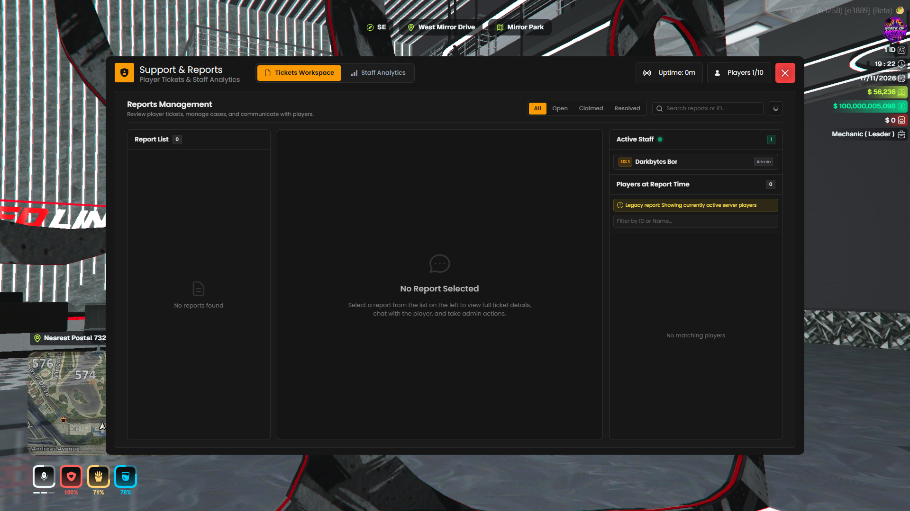
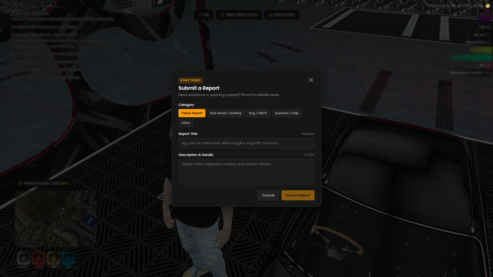
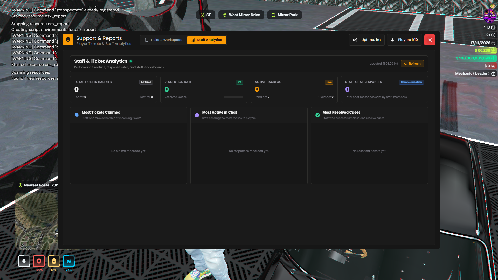

# ESX Support Reports & Staff Analytics

 

A dedicated player support ticketing and staff productivity analytics resource for FiveM servers running **ESX Legacy**.

Built with a direct 3-column Svelte 5 NUI workspace, proximity suspect detection, real-time ticket messaging, and staff performance leaderboards.

---

## 📸 Preview

### 🎟️ Staff Tickets Workspace (`/reports`)
> Complete 3-column resolution canvas with ticket filtering, real-time two-way messaging, accused player information, and historical proximity suspect snapshots.


---

### 📝 Player Report Submission (`/report`)
> Clean modal dialog allowing players to choose categories, input optional suspect IDs, and describe issues. If they have an active ticket, `/report` directly opens their live conversation drawer.


---

### 📊 Staff Productivity Analytics
> Real-time staff performance analytics featuring KPI resolution rates, category breakdowns, and top staff leaderboards (Claimers, Responders, Resolvers).


---

## ⚡ Quick Start

### Commands
* **`/report`** — Used by **players** to file a report or open their active two-way conversation drawer with staff.
* **`/reports`** — Used by **staff members** to open the Support Reports Workspace & Staff Analytics Dashboard.
  * *Aliases:* `/admindashboard`, `/admin`

### Key Features
* 🎫 **Direct Workspace (No Sidebar)**: 100% full-width 3-column ticket resolution canvas.
* 📍 **Historical Proximity Snapshot**: Captures all players within 50m of the reporter at report time with exact distances and click-to-copy IDs.
* 💬 **Live Ticket Chat**: Real-time communication between players and staff without server chat clutter.
* 🚀 **One-Click Staff Actions**: Instant in-ticket `Goto`, `Bring`, and `Spectate` with escape protection.
* 📊 **Staff Performance Analytics**:
  * **Most Tickets Claimed** (Top Claimers leaderboard).
  * **Most Active in Chat** (Top Responders by message volume).
  * **Most Resolved Cases** (Top Resolvers leaderboard).
  * Cumulative KPIs, resolution rates (%), and category distributions.

---

## 🛠️ Installation

1. Place the resource folder in your server's `resources/[esx_addons]/` directory as `esx_report`.
2. Ensure `es_extended` and `oxmysql` start prior to this resource.
3. Add to your `server.cfg`:
   ```cfg
   ensure esx_report
   ```
4. Configure staff groups in `shared/config.lua`:
   ```lua
   Config.AllowedGroups = {
       admin = true,
       -- mod = true,
   }
   ```
5. Restart your server. The resource will automatically migrate its required database tables (`admin_reports` and `admin_report_messages`) via `MySQL.ready`.

---

## 📦 Dependencies
* **Required**: `es_extended`, `oxmysql`
* **Optional Webhook**: Discord Webhook URL for external ticket logging in `shared/config.lua`.
